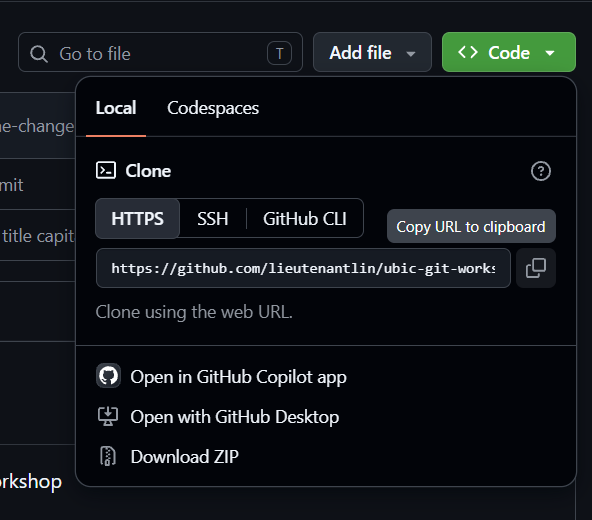

# UBIC Git Workshop Demo
Repository to practice Git skills in UCSD's UBIC Week 8 Workshop

## Setup Git Locally
First download Git from the official website using the following link: 
https://git-scm.com/install/
Choose Windows, macOS, or Linux depending on your operating system and follow the installation instructions.

Open your terminal and type the following.
```bash
git --version
```
You should see the version 2.56.1.

Create your git username and email. Replace "Your Name" with your actual name and "your-email@example.com" with your actual email. (*This is so that when you commit a change, you can be identified as the author of the commit. It is required by Git to have a username and email.*)
```bash
git config --global user.name "Your Name"
git config --global user.email "your-email@example.com"
```

To verify your Git configuration, type the following into your terminal. This should show your name, email, and default branch which should be set to "main".
```bash
git config --list
```
You now have Git installed locally and it's ready to be used!


## Setting up a Local Project Repository

First, create the folder on your local device where you want to host your git repository:

```
mkdir my_github_workshop_project 
cd my_github_workshop_project
```

Then, run the following command to initialize this as your repo:

```
git init
```

A good project is organized so that anyone viewing your work can quickly know where to look for a given project component. Recreate this project structure on your repository (you can use command-line tools or file explorer):

```
my_github_workshop_project/
├── README.md 
├── scripts/
├── notebooks/ 
├── results/
├── figures/ 
├── data/ 
├── env/
└── docs/
```

## Connecting your local work to a GitHub repository

If you haven't started working locally and would like to have access to an existing GitHub repository on your machine, you can clone it with the following command:
```
  git clone https://github.com/username/reponame.git
```
In order to get your repo link, you'll need to navigate to your repository home page, click on the green "Code" button, and copy the HTTPS link that appears.



After cloning, you can switch into the repository directory with `cd reponame`.

On the other hand, if you've already created a local repository with `git init` and would like to connect it to a remote repository created through GitHub, you can use the following command (follow the instructions above to get the repository link):
```
git remote add origin https://github.com/username/reponame.git
```
before using the following to send your changes to the remote repository:
```
git branch -M main
git push -u origin main
```
## Adding Files

To add one singular file enter this command into the terminal,

`git add path/to/filename`

If you want to add all changes made to the files in the current working directory, use this command.

`git add .`

However, using `git add .` adds all changes without confirmation, so if you want to review changes made to existing files in the current directory, you can use this command instead.

`git add -p`

> To get a sense of what files and changes have been commited, you can use the `git status` command

## Commit Your Changes

Commits are used to make saved snapshots of the current branch. They are used to show new files that have been added to the repository and code that has been changed.

To make a commit, you must first stage/add files, so you can only make a commit after running one of the add commands from the previous steps.

To make a commit you can use this command.

`git commit -m "Commit message"`

The commit message should be short, but informative. It should briefly summarize the changes you made to the codebase.

> Example: `git commit -m "Updating the README to add the commiting files section"`
